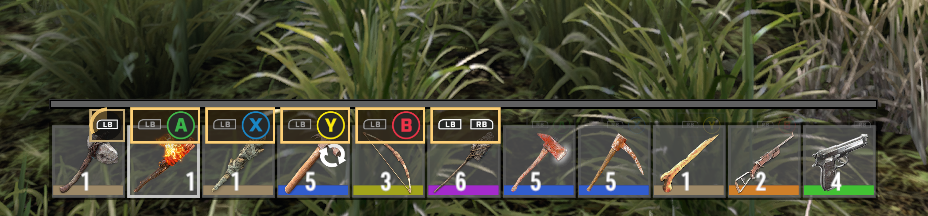
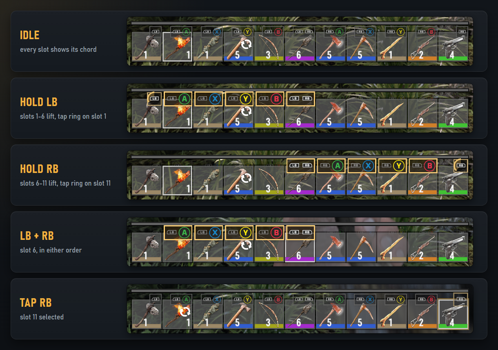

# Gamepad Toolbelt

**Direct toolbelt access for controller players in 7 Days to Die (V 3.3, b18) - plus an 11th toolbelt slot.**

[](https://github.com/o0TheRat1010o/GamepadToolbelt/releases/latest)


[](LICENSE)

On a controller, vanilla only lets you step through the toolbelt with LB/RB one slot at a time (holding LB opens a radial
menu). That is too slow when a zombie is in your face and you need the shotgun *now*. Gamepad Toolbelt maps every slot
to a short chord on the bumpers and face buttons.

**[Download](https://github.com/o0TheRat1010o/GamepadToolbelt/releases/latest)** · [Installation](#installation) ·
[Playing together](#playing-together) · [Troubleshooting](#troubleshooting) ·
[Compatibility](#multiplayer-and-compatibility) · [Configuration](#configuration) · [Console command](#console-command) ·
[FAQ](#faq) · [Building from source](#building-from-source)

| Slot | Controller | | Slot | Controller |
|---:|---|---|---:|---|
| 1 | tap **LB** | | 7 | hold **RB** + **A** |
| 2 | hold **LB** + **A** | | 8 | hold **RB** + **X** |
| 3 | hold **LB** + **X** | | 9 | hold **RB** + **Y** |
| 4 | hold **LB** + **Y** | | 10 | hold **RB** + **B** |
| 5 | hold **LB** + **B** | | 11 | tap **RB** |
| 6 | **LB** + **RB** (either order) | | | |

PlayStation: L1/R1 and Cross/Square/Triangle/Circle in the same positions. Keyboard: `-` (minus) selects slot 11, also
while sprinting.



- **Fast:** while a bumper is held, press face buttons as often as you like to switch between its slots. A bumper that
  is held longer than 0.35 s without a chord cancels (nothing happens), so a nervous thumb never switches by accident.
- **11 slots:** the toolbelt gets an 11th slot (tap RB). Old saves just get an empty slot.
- **Button hints:** a small plate on each slot shows its chord with the game's own Xbox or PlayStation glyphs. While LB or
  RB is held, the reachable slots lift and glow, the others fade, and slot 1/11 shows a draining timer ring; a selection
  pops the plate and flashes the slot. The XP bar slides up a little to make room. With mouse and keyboard the hints
  fade out.
- **Haptics:** a short, light vibration confirms a chord (follows the game's vibration options).
- **Everything else stays vanilla:** A still jumps, B crouches, X reloads, Y uses - unless a bumper is held. Menus, the
  inventory, vehicles (horn/turbo), radial menus, console, chat, map and editors keep their vanilla LB/RB behaviour.
  Swapping uses vanilla's own holster animation and network sync.



## Multiplayer and compatibility

The mod works on every machine it is installed on and never needs the other side:

| Setup | Result |
|---|---|
| Singleplayer | 11 slots, chords, hints |
| You host (listen server) with the mod, friends with the mod | 11 slots for everyone |
| You host with the mod, a friend **without** it | you have 11 slots, your friend 10 (vanilla, fully compatible - they see the correct item in your hands) |
| Dedicated server with the mod, mixed players | like hosting: players with the mod get 11 slots, players without keep 10 |
| You join a server **without** the mod | 10 slots, all chords for slots 1-10 work, hints are shown; tap RB does nothing |

How it stays compatible: the 11th slot is offered through the server's `toolbelt.xml` (a part vanilla ignores), and a
server with the mod never sends a slot number above 10 to other players - neither for the item in your hands nor for
shots and other weapon effects. The hint UI is patched locally on each player's game, so players without the mod get
the unchanged vanilla UI.

**Game version:** built and tested against **V 3.3.0 (b18)**. At start-up the mod checks every hook it needs and turns
a feature off cleanly if something changed in a game update (see `gtb selftest`).

**Controllers:** Xbox, PlayStation and Steam Input (Steam Deck uses the Xbox layout). Controllers that the game itself
does not recognise keep their vanilla behaviour.

**EasyAntiCheat:** the mod contains program code (a DLL), so whoever uses it starts the game without EAC
([installation step 4](#4-start-the-game-without-easyanticheat)) and can then only join servers that do not require EAC.
A dedicated server loads the mod even with EAC enabled; players without the mod can keep EAC on.

**Other mods:** Harmony prefix/postfix patches only, no transpilers. UI mods that rebuild the HUD toolbelt are detected;
the hints are then left out (the chords still work).

## Installation

There is no installer: the mod is a single folder that you copy into the game's `Mods` folder. It takes about two
minutes.

### 1. Download the mod

1. Open the **[latest release](https://github.com/o0TheRat1010o/GamepadToolbelt/releases/latest)**.
2. Under **Assets**, click **`GamepadToolbelt-<version>.zip`** (for example `GamepadToolbelt-1.0.0.zip`) and save it,
   for example in your *Downloads* folder.

Do **not** download *Source code (zip)* - that is the source code for developers, not the mod.

### 2. Open the game's `Mods` folder

1. In Steam, open your **Library**, right-click **7 Days to Die** and choose **Manage → Browse local files**. The game
   folder opens (usually `C:\Program Files (x86)\Steam\steamapps\common\7 Days To Die`).
2. Open the folder **`Mods`**. It already contains a folder **`0_TFP_Harmony`** - it belongs to the game, leave it there.
   If it is missing, right-click the game in Steam and choose **Properties → Installed Files → Verify integrity of game
   files**.

On the Steam Deck, switch to Desktop Mode first; the steps are the same.

### 3. Copy the mod into it

1. Double-click the downloaded ZIP file. Windows opens it like a folder and shows exactly one folder:
   **`GamepadToolbelt`**.
2. Drag this **`GamepadToolbelt`** folder into the `Mods` folder from step 2. If Windows asks for administrator
   permission, click **Continue**.

Afterwards it must look exactly like this:

```
7 Days To Die
└── Mods
    ├── 0_TFP_Harmony            belongs to the game, leave it
    └── GamepadToolbelt
        ├── GamepadToolbelt.dll
        ├── ModInfo.xml
        ├── Settings.xml
        └── README.md, LICENSE, CHANGELOG.md
```

> **Most common mistake:** an extra folder in between, such as `Mods\GamepadToolbelt-1.0.0\GamepadToolbelt\...` (this
> happens with *Extract All...*). The game only looks one folder deep and then does not load the mod. Move the inner
> `GamepadToolbelt` folder directly into `Mods` and delete the empty outer folder.

### 4. Start the game without EasyAntiCheat

The mod contains program code (a DLL). The game only loads such mods when it runs **without EasyAntiCheat (EAC)**.

1. In Steam, click **Play**.
2. Steam asks how to start the game: choose **Launch game without EAC**.

Alternatively choose **Show game launcher**, untick **Use EasyAntiCheat (EAC)** there and start the game.

### 5. Check that it works

- In the game, use your controller: small button plates (LB, A, X, Y, B, RB) appear on the toolbelt slots.
- Or press **F1** to open the console, type `gtb` and press **Enter**: a table with the mod's status appears, and the
  line **Selftest** says `PASS`.

If neither works, see [Troubleshooting](#troubleshooting).

### Playing together

| Who | What to do |
|---|---|
| Everyone who wants the chords | installs the mod (steps 1-5) and starts the game without EAC |
| The player who hosts the game | needs the mod as well if you want the 11th slot - otherwise everyone has 10 slots and the chords for slots 1-10 still work |
| Friends without the mod | nothing to do, they join as usual (with or without EAC) |
| A friend hosts and you have the mod | the host must also start the game **without EAC**, otherwise you cannot join |
| Servers that require EAC | start the game normally (with EAC); the mod then simply stays off |

### Dedicated server

Copy the same `GamepadToolbelt` folder into the `Mods` folder of the server. A dedicated server loads the mod even with
EAC enabled and offers the 11th slot to every player with the mod (set `ToolbeltSlots` to `10` in `Settings.xml` if you
do not want that). Players without the mod keep 10 slots and stay compatible.

### Updating

Download the new ZIP and copy its `GamepadToolbelt` folder over the old one, replacing the files. If you changed
`Settings.xml`, keep your own copy: settings that a new version adds use their default until you add them.

### Uninstalling

1. Empty slot 11 first (move the item elsewhere). If you forget, the game moves it into your backpack the next time you
   load the save, or drops it next to you if the backpack is full.
2. Delete the folder `Mods\GamepadToolbelt`.

### Troubleshooting

- **No button plates and the chords do nothing:** check step 3 (no extra folder in between) and step 4 (started without
  EAC). If the console does not know `gtb` (*unknown command*), the mod was not loaded - it is one of these two.
- **The plates disappear:** they only show while you play with a controller; with mouse and keyboard they fade out.
  `HintMode` in `Settings.xml` controls them.
- **Only 10 slots:** the host or the server does not have the mod. Everything else works; tapping RB just does nothing.
- **Game version:** the mod is made for **V 3.3 (b18)**. After a game update, `gtb selftest` shows what still works.
- **Still stuck?** [Open an issue](https://github.com/o0TheRat1010o/GamepadToolbelt/issues) and paste the output of
  `gtb status` and `gtb selftest`.

## Configuration

`Mods/GamepadToolbelt/Settings.xml` (open it with any text editor, e.g. Notepad). Everything applies live with the
console command `gtb reload`, except `ToolbeltSlots`, which is read when a world is loaded. Invalid values are reported
in the log and fall back to the default.

| Setting | Default | Meaning |
|---|---|---|
| `Enabled` | `true` | Master switch for the controller chords. `false` = vanilla toolbelt controls. |
| `TapMaxSeconds` | `0.35` | A bumper released within this time (0.10 - 1.00) without a chord selects slot 1/11; longer cancels. |
| `AllowWhileAiming` | `true` | Chords also while aiming down sights (switching lowers the weapon like vanilla). |
| `HintMode` | `Always` | `Always`, `WhileHeld` (only while LB/RB is held) or `Off`. Hints show only in controller mode. |
| `HintIdleOpacity` | `0.8` | Opacity of the hints while no bumper is held (0 - 1). |
| `Haptics` | `true` | Short vibration on a chord. |
| `HapticStrength` | `0.25` | Vibration strength (0.05 - 1). |
| `HapticMs` | `50` | Vibration length in milliseconds (20 - 300). |
| `KeyboardSlot11Key` | `Minus` | Keyboard key for slot 11 (an InControl key name such as `Minus`, `Equals`, `Backquote`, or `None`). Not with Ctrl/Alt; with Shift (sprinting) it works too, except in god or fly mode, where vanilla uses Shift+Minus for the fly speed. |
| `ToolbeltSlots` | `11` | Toolbelt size this machine offers when it hosts a world: `11` or `10`. |
| `LogLevel` | `Summary` | Audit log: `Off`, `Summary`, `Detailed`. |
| `SelfCheckScreenshots` | `false` | Saves one screenshot of each hint state per session (diagnostics). |

## Console command

`gtb` (or `gamepadtoolbelt`) runs on the machine where you type it - also when you play as a guest on a server without
the mod:

| Command | |
|---|---|
| `gtb status` | Version, settings, patch groups, toolbelt size, controller, statistics, audit log file. |
| `gtb selftest` | All self checks (PASS/WARN/FAIL). |
| `gtb reload` | Re-read `Settings.xml`. |
| `gtb loglevel off\|summary\|detailed` | Change the audit log level for this session. |
| `gtb chords` | The controller layout of your current toolbelt. |
| `gtb screenshot [name]` | Save a screenshot to `Mods/GamepadToolbelt/Logs/screens`. |

## Audit log and diagnostics

Every session writes `Mods/GamepadToolbelt/Logs/audit_<date>.jsonl` (files roll over at 50 MB, at most 10 are kept).
`Summary` contains one line per chord and its result (with the time until the slot was held); `Detailed` adds every
button the mod takes from the game and every change of the toolbelt state. A selftest runs at every game start and again
once your character has spawned. Warnings and errors also appear in the game log with the prefix `[GamepadToolbelt]`.
If the controller layer fails repeatedly it switches itself off (vanilla controls) until `gtb reload`.

## FAQ

**Can I still jump while holding LB?** Not with A - while a bumper is held, A/X/Y/B belong to the chord. Release the
bumper and A jumps again. A face button you were already holding before the bumper keeps working.

**Can I change the buttons?** The layout is fixed (bumpers + face buttons). Rebinding the game's own actions still works
for everything else.

**Does the mod change my save?** No save data of its own. The toolbelt has 11 slots while the mod is active; old saves
get an empty 11th slot, and removing the mod moves the slot 11 item into your backpack.

**I started the game with EAC by accident - what happened?** The mod was simply not loaded: vanilla controls and 10
slots. In a singleplayer save the game moved the item from slot 11 into your backpack, just like after uninstalling.
Start without EAC next time and put it back.

**What about the death backpack?** The game's dropped backpack holds 120 items: 96 bag + 13 equipment + 11 toolbelt fit
exactly. (Mods that enlarge the bag further are reported by the selftest.)

**Twitch integration "shuffle"?** The game's shuffle action leaves out the last toolbelt slot (slot 11 with the mod).

## Building from source

Requirements: .NET SDK 8 or newer, the .NET Framework 4.8 targeting pack, and an installed copy of the game (the build
references the game's DLLs; none are included in this repository).

```
copy GamePath.user.props.example GamePath.user.props   (and set your game path)
dotnet build -c Release
dotnet build GamepadToolbelt/GamepadToolbelt.csproj -c Release -p:GtbDeploy=true   (also copies the mod into <game>/Mods/GamepadToolbelt)
```

The game path can also be given with `-p:SdtdGamePath=...` or the environment variable `SDTD_GAME_PATH`.

## License

MIT - see [LICENSE](LICENSE). Made by softdot.studio. 7 Days to Die is a trademark of The Fun Pimps; this is an
unofficial fan project. Button glyphs are drawn from the game's own icon atlas at runtime; no game assets are included.
